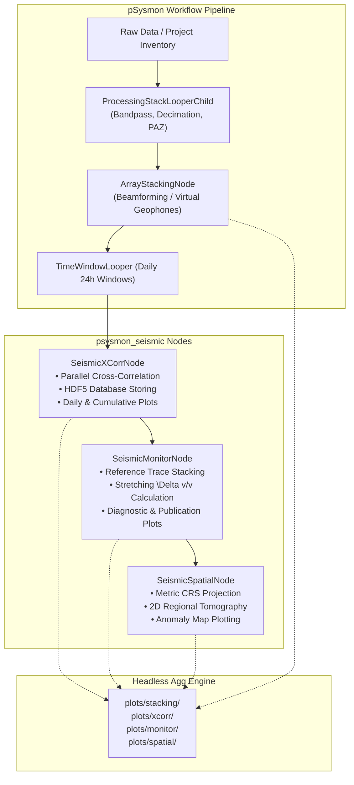

# SeisMIC & psysmon_seismic Project Handoff Document

> **Document Purpose**: This file serves as the definitive architecture summary, operational guide, and context checkpoint for the integration between **SeisMIC** (Passive Seismic Interferometry) and **pSysmon** (Modular Geophysical Processing Framework). It enables any AI assistant or developer to instantly resume work with zero context loss.

---

## 1. Executive Summary & Session Provenance

- **Original Conversation Title**: *SeisMIC Codebase Architecture Analysis*
- **Source Conversation ID**: [`f4fc0901-46b4-48f9-b4f7-12ba47ad1ffe`](file:///home/db/.gemini/antigravity/brain/f4fc0901-46b4-48f9-b4f7-12ba47ad1ffe/.system_generated/logs/transcript_full.jsonl)
- **Primary Objective**: Thoroughly analyze the native SeisMIC architecture and build a clean, high-performance, non-invasive integration package (`psysmon_seismic`) that embeds SeisMIC cross-correlation, monitoring (\(\Delta v/v\)), 2D spatial tomography, and array beamforming into pSysmon's graphical workflow pipeline.
- **Architectural Policy**: **Core SeisMIC code is kept 100% untouched.** All adaptation, glue logic, GUI dialogs, performance caching, and headless plotting engines are encapsulated within `psysmon_seismic` and dedicated pSysmon plug-ins.

### Key Working Directories
- **SeisMIC Core Library**: [`/home/db/Software/SeisMIC`](file:///home/db/Software/SeisMIC) (Git branch `main`, tagged `v0.7.2-beta`)
- **Integration Package**: [`/home/db/Software/psysmon/psysmon_seismic`](file:///home/db/Software/psysmon/psysmon_seismic) (Git branch `main`, versions `0.1.0` through `0.3.1`)
- **pSysmon Framework Root**: [`/home/db/Software/psysmon/psysmon`](file:///home/db/Software/psysmon/psysmon)

---

## 2. SeisMIC Core Architectural Analysis

SeisMIC is a Python package designed for passive seismic interferometry, ambient noise cross-correlation, and time-lapse monitoring of relative seismic velocity variations (\(\Delta v/v\)).

### 2.1 Core Subsystems
1. **`seismic.correlate`** ([`src/seismic/correlate/`](file:///home/db/Software/SeisMIC/src/seismic/correlate)):
   - **Stream Pre-processing**: Time-domain and frequency-domain pre-conditioning, including clipping, 1-bit normalization, running average normalization, and spectral whitening.
   - **Cross-Correlation**: Computes cross-correlation functions (CCF) using FFT-based correlation (`scipy.fft` / NumPy) with sub-windowing and linear, phase-weighted, or robust stacking.
   - **Decimation**: Downsamples raw high-rate seismic streams to target correlation sample rates.
2. **`seismic.db.corr_hdf5`** ([`src/seismic/db/corr_hdf5.py`](file:///home/db/Software/SeisMIC/src/seismic/db/corr_hdf5.py)):
   - **Persistent HDF5 Storage**: Efficient storage structure organizing CCFs hierarchically by station pairs (e.g., `AP231-AP232`) and chronological dates (`YYYY-MM-DD`).
   - **Append & Cumulative Mechanics**: Allows daily incremental updates, forming a continuous multi-month timeline of cross-correlation functions.
3. **`seismic.monitor`** ([`src/seismic/monitor/`](file:///home/db/Software/SeisMIC/src/seismic/monitor)):
   - **`dv.py` & `stretch_mod.py`**: Computes relative velocity variations (\(\Delta v/v\)) using the stretching method. Warps candidate daily cross-correlations against a reference trace (stacked across the quietest periods) and computes similarity matrices / coherence.
   - **`wfc.py`**: Waveform coherence analysis and cross-spectral phase tracking.
   - **`spatial.py`**: Regional 2D tomography inversion. Translates inter-station \(\Delta v/v\) measurements into spatial 2D velocity variation maps using sensitivity kernels (straight-ray or 2D scattering approximations) in metric Cartesian coordinates.
4. **`seismic.plot`** ([`src/seismic/plot/`](file:///home/db/Software/SeisMIC/src/seismic/plot)):
   - Matplotlib visualization routines: `plot_correlation` (record sections, heatmaps, stacks), `plot_dv` (technical 3-panel, fancy publication scatter), `plot_multidv` (network overlay with median), and `plot_wfc`.

---

## 3. `psysmon_seismic` Architecture & Module Inventory

The package [`psysmon_seismic`](file:///home/db/Software/psysmon/psysmon_seismic) connects SeisMIC to pSysmon's graphical node tree and `TimeWindowLooper` workflow engine.



### 3.1 Implemented Nodes & Modules
| Module | Primary Class | Role & Capabilities |
| :--- | :--- | :--- |
| [`processing_nodes.py`](file:///home/db/Software/psysmon/psysmon_seismic/processing_nodes.py) | `ArrayStackingNode` | Array beamforming. Groups sub-array geophones (e.g. `AP231A, B, C`) into virtual stations (`AP231`). Modes: `'replace'` or `'replicate'`. Computes centroid lat/lon/elev dynamically in-memory. |
| [`seismic_xcorr.py`](file:///home/db/Software/psysmon/psysmon_seismic/seismic_xcorr.py) | `SeismicXCorrNode` | Looper child node executing cross-correlation on 24h stream slices. Supports multi-core parallel correlation, persistent HDF5 writing, and auto-generated daily/cumulative figures. |
| [`seismic_monitor.py`](file:///home/db/Software/psysmon/psysmon_seismic/seismic_monitor.py) | `SeismicMonitorNode` | Time-series stretching analysis. Reads HDF5 correlation databases, computes reference traces, extracts \(\Delta v/v\) and coherence, and outputs diagnostics. |
| [`seismic_spatial.py`](file:///home/db/Software/psysmon/psysmon_seismic/seismic_spatial.py) | `SeismicSpatialNode` | 2D regional velocity variation tomography. Reprojects lat/lon to Cartesian metric CRS (EPSG), computes sensitivity kernels, performs inversion, and plots 2D maps. |
| [`gui.py`](file:///home/db/Software/psysmon/psysmon_seismic/gui.py) | UI Panels & Tabs | Custom wxPython dialogs, tabbed preferences (`Grouping`, `Stacking`, `Plots`), dynamic output directory resolution, and validation. |
| [`client.py`](file:///home/db/Software/psysmon/psysmon_seismic/client.py) & [`utils.py`](file:///home/db/Software/psysmon/psysmon_seismic/utils.py) | Utilities & Bridges | Safe coordinate transforms, centroid recalculation, inventory extraction, and path management. |
| [`__init__.py`](file:///home/db/Software/psysmon/psysmon_seismic/__init__.py) | Package Entry & Fallback | Non-intrusive locale wrapper preventing `locale.Error` on Linux systems missing `en_GB.utf8`. |

---

## 4. Key Technical Challenges & Implemented Solutions

### 4.1 Headless Automated Visualization Engine (v0.3.0)
- **Problem**: SeisMIC's plotting functions are designed for interactive Matplotlib windows. Running them inside a pSysmon background looper caused UI freezing, X11 display errors on headless servers, and memory leaks.
- **Solution**:
  - Implemented headless execution using Matplotlib's non-interactive `Agg` backend.
  - Guaranteed figure cleanup with strict `plt.close(fig)` / `plt.close('all')` blocks.
  - Added dedicated `'Plots'` preference tabs to all 4 nodes (`plot_dir`, `plot_format`, `plot_dpi`, figure checkboxes).
  - Output directories auto-resolve to `<looper_dir>/plots/{stacking,xcorr,monitor,spatial}/` when left blank.

### 4.2 Record Section Spacing & Anti-Aliasing (v0.3.1)
- **Problem**: In `xcorr_section` record sections, high-amplitude wiggles overlapped adjacent lanes, creating an illegible solid black block. Furthermore, anti-aliasing caused wiggles to appear washed-out greyscale.
- **Solution**:
  - Reduced amplitude scaling to `0.40 * trace_interval / 1e5`, strictly confining wiggle peaks to their vertical lane with \(\ge 20\%\) guaranteed whitespace.
  - In cumulative summary mode (`_cumulative`), automatically stacks multi-day sub-windows into **1 high-SNR daily stacked wiggle per calendar day** spaced by 24 hours ($86,400\text{ s}$).
  - Set `linewidth = 0.5` pt, disabled anti-aliasing (`line.set_antialiased(False)`), and enforced pure black (`#000000`). Produces crisp, 1-pixel pure-black hairlines without grey halos.
  - Dynamic vertical scaling: `Full Looper Period (Progressive Fill)` locks full duration height, while `Current Accumulated Days (Elastic Growth)` sizes canvas dynamically.

### 4.3 High-Performance Processing Stack Accelerations (v0.2.0)
- **Strided `IntegerDecimation` Node**:
  - Developed a specialized sampling node in `processingNodes.py`.
  - When following a bandpass filter (which suppresses frequencies above Nyquist by > 80 dB), `apply_low_pass_filter = False` performs contiguous strided slicing `data[::factor]`.
  - Takes **0.054 seconds** per 24h trace (**160\times faster** than Fourier sinc resampling) with zero phase distortion or aliasing.
- **Vectorized PAZ Response Removal**:
  - Cached instrument transfer functions and vectorized pole-zero response calculations across multi-channel streams.

### 4.4 GUI Layout & Accessibility Fixes in pSysmon Core
- **Processing Stack Dialog Width Decoupling**: Refactored `PStackEditPanel` and `ProcessingStack` from `wx.GridBagSizer` to a nested `wx.BoxSizer` hierarchy (`mainSizer` + `topSizer`). Fixed the issue where selecting wide nodes compressed the node listbox width.
- **Color-Blind Friendly Disabled Node Styling**: Implemented typographic strikethrough (`font.SetStrikethrough(True)`), muted grey text (`GREY70`), and delete icons for disabled nodes, while restoring `wx.NullColour` (native whitish theme color) for enabled nodes.
- **Looper Child Synchronization**: Ensured individually disabled child nodes inside a looper are correctly marked with disabled styling even when the parent looper remains active.

---

## 5. Verification & Test Suite

All functionality is validated by an automated unit and integration test suite in [`psysmon_seismic/tests/test_integration.py`](file:///home/db/Software/psysmon/psysmon_seismic/tests/test_integration.py).

### How to Run Tests
```bash
PYTHONPATH=/home/db/Software/psysmon:/home/db/Software/SeisMIC /home/db/Software/psysmon/bin/python -m unittest psysmon_seismic.tests.test_integration
```

### Test Coverage Overview (23 Tests, All Passing)
- **`test_01`–`test_03`**: Array stacking modes (`replace`, `replicate`, raw stream warning).
- **`test_04`**: Complete end-to-end pipeline (Stack &rarr; Looper Correlate &rarr; Monitor &rarr; Spatial).
- **`test_05`–`test_07`**: Path resolution, metadata persistence, in-memory centroid inventory calculation.
- **`test_08`**: ArrayStackingNode tabbed preferences layout (`Grouping`, `Stacking`, `Plots`).
- **`test_09`**: Spatial metric CRS enforcement and reprojection.
- **`test_10`**: Parallel correlation multi-core execution.
- **`test_11`–`test_13`**: Processing stack GUI sizing and dialog components.
- **`test_14`–`test_16`**: Vectorized equivalence verification.
- **`test_17`–`test_18`**: Processing stack acceleration, decimation, PAZ caching, and deepcopy compatibility.
- **`test_19`**: Plotting preferences schema, headless rendering, and file generation across all four nodes.
- **`test_20`**: Array stacking preference label and tooltip streamlining.
- **`test_21`**: Decoupled `wx.BoxSizer` layout in `PStackEditPanel` and `ProcessingStack`.
- **`test_22`**: Collection disabled node styling (strikethrough and `wx.NullColour` restoration).
- **`test_23`**: Looper child disabled status logic.

---

## 6. How to Resume Work in a New Conversation

When starting a fresh conversation, provide this prompt to resume immediately without redundant discovery:

```markdown
Please read the project handoff document at:
/home/db/Software/psysmon/psysmon_seismic/HANDOFF.md

The SeisMIC and psysmon_seismic integration is complete, stable, and verified with 23 passing tests.
Please pick up from here and help me with: [DESCRIBE YOUR TASK HERE]
```

### Potential Future Enhancements
1. **3D Spatial Tomography**: Extending `SeismicSpatialNode` from 2D depth-averaged slices to full 3D sensitivity kernels.
2. **Frequency-Wavenumber ($f$-$k$) Beamforming**: Enhancing `ArrayStackingNode` with slowness/back-azimuth grid search steering vectors.
3. **Packaging & PyPI Distribution**: Building wheel distributions for standalone pip installation of `psysmon_seismic`.
